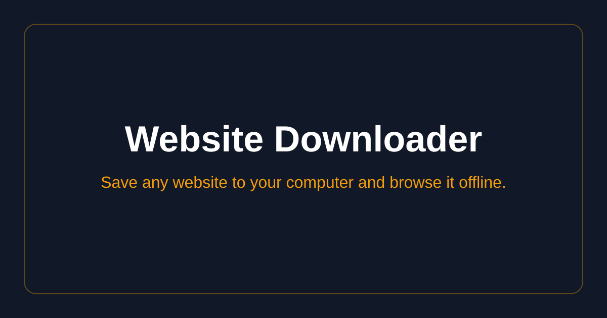
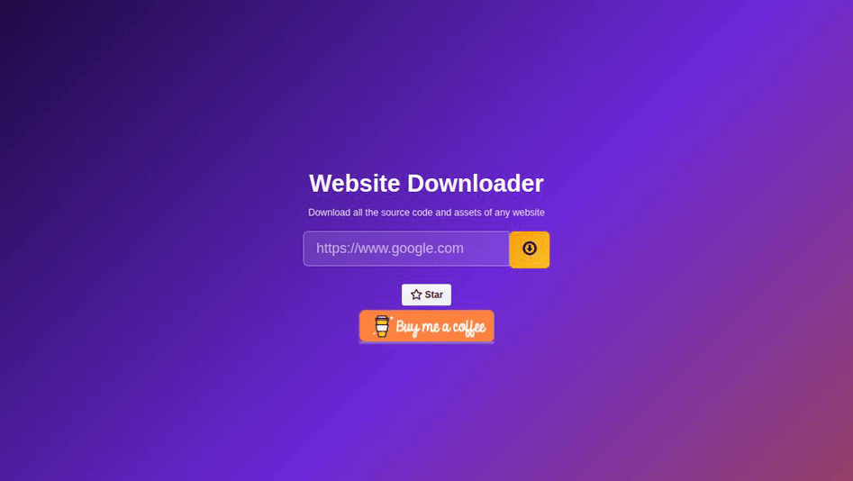

# Website Downloader

[](https://github.com/mrabr381/website-downloaderr/actions/workflows/ci.yml)

Save any website to your computer and browse it offline.

👉 **Try it live:** https://mrabr381.github.io/website-downloaderr/

## Quickstart

```bash
git clone https://github.com/mrabr381/website-downloaderr.git
cd website-downloaderr
npm install
npm start
```

Then open http://localhost:3000/

## What it does

Paste a website address and the app downloads the whole site — pages, stylesheets, images and other assets — using `wget` and `archiver`, compresses it into a file, and sends it back to you through a live socket connection.



## Requirements

- Node.js 16 or newer
- `wget` on the `PATH` — the app shells out to it, and nothing will download without it:
  - Debian/Ubuntu: `apt install wget`
  - macOS: `brew install wget`
  - Windows: `winget install JernejSimoncic.Wget`

### Optional settings

| Variable | Default | What it does |
| --- | --- | --- |
| `PORT` | `3000` | Port the server listens on |
| `DOWNLOAD_QUOTA` | `500m` | Size ceiling passed to wget, so one request cannot fill the disk |
| `DOWNLOAD_TIMEOUT_MS` | `1800000` | How long a single download may run before it is stopped |

## How the download works

The app runs `wget --mirror --convert-links --adjust-extension --page-requisites --no-parent http://example.org` — recursive download, links rewritten for offline viewing, kept within the requested part of the site.

## Deploy on cloud providers

[](https://replit.com/github/mrabr381/website-downloaderr)
[](https://railway.app/new/template?template=https://github.com/mrabr381/website-downloaderr)
[](https://app.koyeb.com/deploy?type=git&repository=github.com/mrabr381/website-downloaderr&branch=main&name=website-downloaderr)
[](https://render.com/deploy?repo=https://github.com/mrabr381/website-downloaderr)

## How to contribute

- Open issue(s) with any bugs you notice.
- Please create pull requests if you think it would be an added value towards our program.
